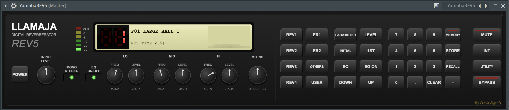

# Llamaja REV5 - Digital Reverberator

**Llamaja REV5** is a digital reverberation unit inspired by classic 80s hardware[cite: 25]. This plugin combines vintage algorithms with modern FDN (Feedback Delay Network) architecture, providing incredibly dense, natural, and highly customizable spaces for your mixes[cite: 25].

Developed in **C++17** using the **JUCE Framework (v7/v8)**[cite: 14, 35].

## 🚀 Features

* **Advanced FDN Reverb Engine:** 8x8 Feedback Delay Network with lossless Hadamard mixing for exponentially growing echo density[cite: 12, 26].
* **Independent Early Reflections (Moorer):** 8 distinct reflection taps per channel using prime-number-based delay times to prevent phase cancellation[cite: 12, 26].
* **Pre-Diffuser & Stereo Modulation:** 4 Schroeder Allpass filters in series to smooth transients, coupled with independent LFO modulation (Sine/Cosine) for wide stereo decorrelation[cite: 12, 26].
* **Dual 3-Band EQ System:** 
  * **Pre-EQ:** Clean up the signal before it hits the reverb tank[cite: 26].
  * **Prog-EQ:** Shape the tone of the wet tail exclusively[cite: 26].
* **Visual Feedback:** Features a dynamic spectrum pixel animation on the LCD display[cite: 10, 11, 26].
* **Hardware-Style Workflow:** Quick access to 24 Factory Presets (Large Halls, Rooms, Plates, etc.) and 8 User memory slots[cite: 12, 13, 25, 33].
* **Robust DSP:** 32-bit floating point internal processing with a built-in 1-pole high-pass DC Blocker to prevent offset accumulation on long tails[cite: 12, 35].

## 🛠️ Technical Specifications

* **Format:** VST3, AU, Standalone[cite: 14, 31]
* **OS Compatibility:** macOS (11.0+, Intel & Apple Silicon), Windows (64-bit)[cite: 31]
* **Sample Rates:** 44.1kHz to 192kHz[cite: 35]
* **Channels:** True Stereo Processing[cite: 35]

## ⚙️ Installation & Build

### Download Pre-compiled Binaries
You can download the latest `.zip` package for Mac or Windows from the [Releases page](../../releases)[cite: 31]. 
Move the extracted files to your system's VST3 or Components folder and rescan your DAW[cite: 31].

### Build from Source (CMake)
Run the following commands in your terminal:

    git clone https://github.com/DavidSignals/LlamajaREV5.git
    cd LlamajaREV5
    mkdir build && cd build
    cmake ..
    cmake --build . --config Release

## 🎛️ User Manual
For a detailed explanation of the interface controls, practical applications (Vocal Processing, Drum Bus, Guitars), and troubleshooting, please refer to the official [User Manual (PDF)](assets/LlamajaRev5.pdf)[cite: 23, 24, 34].

## 👨‍💻 About the Developer
**David Rábago Félix (David Signals)**  
Audio Plugin Developer & Mechatronic Engineer specializing in C++ and DSP[cite: 23, 38].  
* [GitHub](https://github.com/DavidSignals)[cite: 38]
* [LinkedIn](https://www.linkedin.com/in/davidrabagofelix)[cite: 38]
